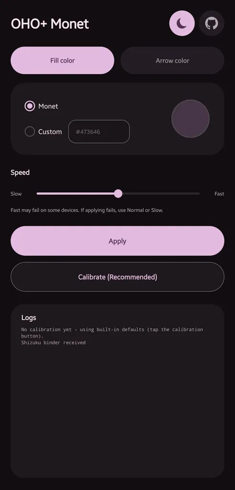
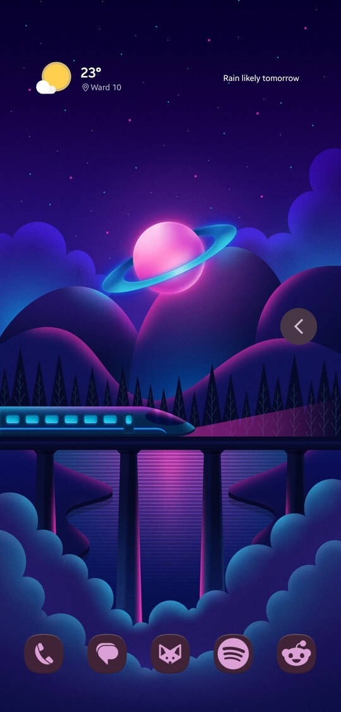
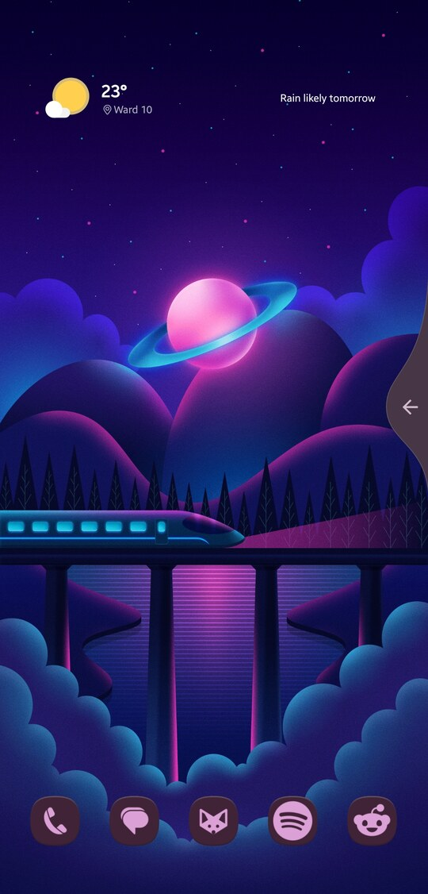

<h1> OHO+ Monet</h1>

This app was made to set Monet colors (or a custom color) for One Hand Operation+ handles, support **Arrow 3** and **Curved line** styles.

**Shizuku** is required for the app to work. The app has no internet permission.

## Screenshots

| App | Arrow 3 | Curved line |
| :-: | :-----: | :---------: |
|  |  |  |

## Installation

Download the latest APK from GitHub, or add the repository to Obtainium to get updates automatically.

## How it works

One Hand Operation+ doesn't let you type a color code, so the app sets the colors by emulating screen taps in the OHO+ settings.

Screen taps and calibration were made and tested only on a **Samsung Galaxy A55**. I can't guarantee it will work on other devices. Run the in-app **Calibration** once before applying colors.
